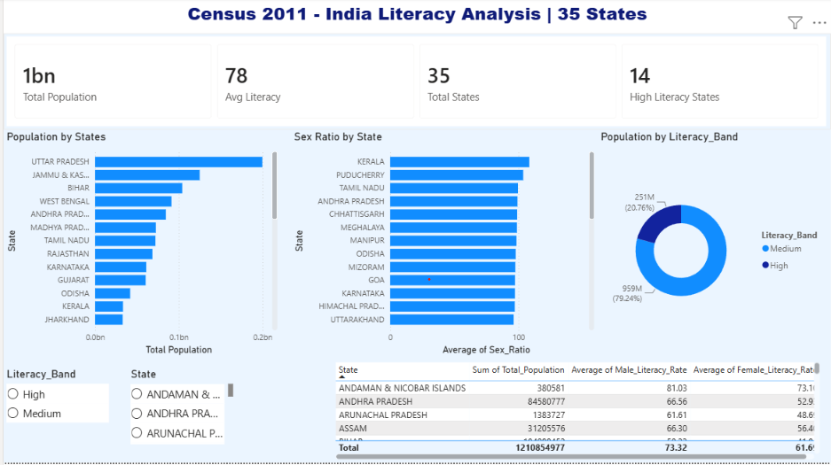

# Census 2011 - India Literacy Analysis

An end-to-end data analysis project on Census 2011 data covering 35 States / UTs of India, focusing on Literacy Rate, Population, and Sex Ratio.

**Tools Used:** Python | Pandas | MySQL | Excel | Power BI  
**Data Source:** Census of India - censusindia.gov.in

---

## Project Workflow

### 1. Data Collection - Python Web Scraping
- Accessed the official Census catalogue page.
- Extracted the `.xlsx` file link using `requests` + `BeautifulSoup`.
- Downloaded and stored the raw file in `data/raw/`.

### 2. Data Cleaning - Python
- Standardized column names.
- Filtered only `STATE` level and `Total` records.
- Removed the all-India aggregate row.
- Converted columns to numeric types and handled missing values with median imputation.

### 3. Exploratory Data Analysis (EDA)
Created new calculated metrics:
- **Literacy Rate (%)** = Literate Persons / (Population - Population Age 0-6) * 100
- **Sex Ratio** = Female / Male * 1000
- **Literacy Band** = High (80+), Medium (60-80), Low (<60)
- Created state-wise summary using `groupby()`.

### 4. Database - MySQL
- Created database `census_db` and table `census_cleaned`.
- Imported cleaned data from Python using `mysql-connector-python`.
- Handled duplicates using `ROW_NUMBER() OVER (PARTITION BY email ORDER BY id)`.
- Ran analytical queries to identify top and bottom performing states.

### 5. Excel Analysis
Created `census_analysis.xlsx` with 3 sheets:
- **Raw:** Original data
- **Clean:** Cleaned data
- **Summary:** State-wise aggregated summary
- Validated results using Pivot Tables.

### 6. Visualization - Power BI Dashboard
- KPIs: Total Population, Average Literacy, Average Sex Ratio
- Bar Chart: Top 10 States by Population
- Bar Chart: Literacy Rate by State
- Map: State-wise Literacy Distribution
- Slicer: Literacy Band

---

## Key Findings

| Metric | Highest | Lowest |
| :--- | :--- | :--- |
| Literacy Rate | Kerala - 94% | Bihar - 61.8% |
| Sex Ratio | Kerala - 1084 | Haryana |

---

## Project Structure

Census_Project/
├── census.py
├── README.md
├── data/
│   ├── raw/census2011.xlsx
│   └── cleaned/
│       ├── census_cleaned.csv
│       ├── state_summary.csv
│       └── census_analysis.xlsx
├── output/
│   └── graphs/bar_population.png
└── Census_2011_Literacy_Analysis.pbix

## How to Run

pip install requests pandas beautifulsoup4 mysql-connector-python
python census.py
1. Run `census.py` to scrape and clean the data.
2. Import the cleaned data into MySQL.
3. Open `Census_2011_Literacy_Analysis.pbix` in Power BI to view the dashboard.

